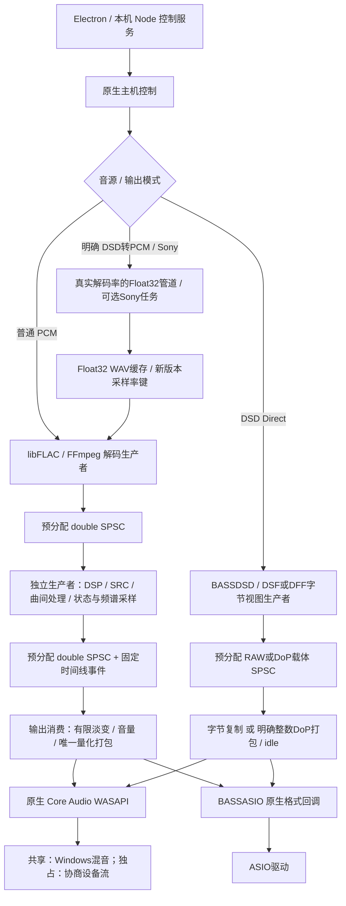

# 音频链路专项修复与测试报告

日期：2026-10-10。分支：`local/development`。修复前基线：`864a8e0db468507de7ab8400f17c817a4767ea87`（`checkpoint/ffmpeg-libflac-soxr`）。本轮依据仓库外的原专项审查报告，获得“全部修复、测试、出具报告”的授权后实施。此文档是修复后的验收记录，不替代原始审查证据。

## 1. 结果与范围

**原报告 F01–F08 均已修复。** R01–R07、R09–R10 已通过代码修正或明确拒绝不透明组合来处理；R08 的 Sony 原厂内部精度/削波仍属于外部算法边界，保留真实精度报告与 Direct 隔离，不虚构全链 Float64。G08 的 DSP 后预分配传输已实现，其余可选目标的实际状态见第 4 节。

已完成原生主机、TypeScript 和 Vite 构建；核心检查 32 项通过；实际解码器、DSD 离线组件、实时回调 mock、量化器及遥测测试通过；默认 WASAPI 设备的合成 PCM 静音回归 14 项通过。测试中发现的额外定位、资源生命周期及重播问题也已修复。

没有读取个人音乐，没有发送真实 DSD/DoP，没有初始化 ASIO 硬件，没有修改驱动、系统主音量、全局环境或新增依赖。编译器、库和 CLI 均复用项目已有文件。未联网、未上传、未推送、未制作最终包。

本轮委派了 PCM 打包、DSD 转换、WASAPI/遥测机械性检查和独立复核；原生创建参数明确请求 `gpt-6-luna / max`。客户端未单独返回实际生效档位字段，不能进一步声称已核验运行模型。主 Agent 复核、整合与执行最终测试。

## 2. 修复后的实际架构

### 四条数据流

1. **PCM Direct：**容器 → libFLAC 或符合资格的 FFmpeg 无损整数解码 → 精确二次幂归一化 double → 解码 SPSC → 不运行 DSP/SRC/RG/曲间混音 → 提交 SPSC → unity、无 dither 的整数打包 → WASAPI 独占或 ASIO 原生整数。WASAPI 的有效位左对齐与 ASIO 的有效位右对齐分开；打包后按真实有效位还原并逐样本比较。检查仅覆盖应用提交边界，不认证驱动/DAC。
2. **PCM DSP：**解码 → double → 解码 SPSC → double RG/音调/EQ → 必要且明确的 SRC → 曲间过渡 → double 提交 SPSC → double 音量/运输淡变 → 最终 Float32 或整数舍入、饱和及所选 dither → 输出。没有新增 Float64/Float32 往返；Float32 源扩展为 double 不恢复源中已丢失的信息。
3. **DSD Native / DoP：**DSF/DFF 解析/有效尾部整理 → BASSDSD RAW 或可逆 Float32 DoP 载体 → 独立预分配字节队列 → Native 原字节回调，或整数载荷恢复/marker/idle 打包 → 已验证格式的驱动接口。完全绕过 PCM DSP、SRC、音量及 dither。ASIO DoP 不再使用 ChannelEnableBASS helper；ASIO 原生 Float32 DoP 暂拒绝。Native 仍要求驱动实际支持 DSD，不按驱动名称猜测。
4. **DSD-to-PCM：**明确选择转换 → BASSDSD 实际 PCM 解码率（本次测试为 44.1/48kHz）→ Float32 管道 → 可选 Sony/DSEE（支持时四倍输出率）→ 按真实率写 Float32 缓存 → 扩展 double → 普通 PCM DSP/输出路线。没有改写源文件；旧错误率缓存不删除，但新规则不复用旧键。

## 3. 原报告逐项修复

### 已证实缺陷 F

| 编号 / 原严重度 | 本轮结果与影响 | 主要源码 / 函数 | 验证 |
|---|---|---|---|
| F01 / P1 | ASIO 32BIT16/18/20/24 按右对齐打包；符号扩展正确。WASAPI 保持左对齐。Direct 检查读取实际有效位，避免错误打包与错误自检相互掩盖 | [pcm-engine.h:395](../native/pcm-engine.h:395) `PcmQuantizer::configure/write`；[audio-host.cpp:1463](../native/audio-host.cpp:1463) | 各容器/有效位、正负边界、损坏 payload 和 Direct 离线检查通过；没有对应真实 ASIO 驱动认证 |
| F02 / P2 | 毫秒换成帧，按驱动 min/max/preferred/granularity 或二次幂约束选择；请求值与实际块长分别报告，0 保留驱动默认 | [asio-buffer-config.h:8](../native/asio-buffer-config.h:8) `asioBufferFrames`；[audio-host.cpp:1414](../native/audio-host.cpp:1414) | 单位、上下界、粒度与二次幂 mock 通过 |
| F03 / P1 | 原生 PCM 管道率进入 runner，不再将实际 48kHz 样本写成 44.1kHz；时长/缓存头/任务身份一致。无原生管道时 ffmpeg 使用明确的目标率 | [sony-walkman.mjs:23](../scripts/sony-walkman.mjs:23) `dsdPcmRateFromSourceRate`；[runner.py:37](../scripts/sony-walkman/runner.py:37) `select_processing_input_rate` | 真实 BASSDSD 的 DSF/DFF 两采样率家族验证通过；DSEE 时间基纯逻辑组合通过 |
| F04 / P1 | DSP/SRC/队列/锁/动态 JSON 移至生产者；常规 PCM 回调仅消费预分配块、有限淡变/音量、量化及 POD 统计。控制任务改成调用方持有的单槽邮箱 | [rt-pcm-buffer.h:94](../native/rt-pcm-buffer.h:94)；[audio-host.cpp:760](../native/audio-host.cpp:760) `produceAsioPcm` / `asioPcmOutput`；[wasapi-output.h:963](../native/wasapi-output.h:963) `renderOnce` | 真实生产回调与 fake COM 提交路径 mock；回调期间 C++ new 次数为 0；队列并发/边界测试通过 |
| F05 / P1 | RAW/DoP 文件/解码读取由可取消生产者执行，设备回调只消费整帧；不在启动控制线程同步预读源样本 | [rt-dsd-buffer.h:17](../native/rt-dsd-buffer.h:17) `RtDsdBuffer`；[audio-host.cpp:1051](../native/audio-host.cpp:1051) `dsdOutput` | RAW 身份、DoP 载荷/marker/idle、EOF/欠载/取消 mock 与实际离线组件通过 |
| F06 / P1 | ASIO C ABI 回调异常隔离、输出有效静音并失败关闭；WASAPI lease 保证成功获取后释放一次，DoP 异常路径填合法 idle | [wasapi-output.h:924](../native/wasapi-output.h:924) `RenderBufferLease`；[audio-host.cpp:819](../native/audio-host.cpp:819) | Acquire 失败、正常释放、异常释放、DoP idle、非法/并发回调 mock 通过 |
| F07 / P2 | callback 与 driver-native 的格式、容器、有效位、对齐分别回报；未知不冒充；实际缓冲帧、请求值、系统/驱动/应用管理主体分开 | [audio-host.cpp:1309](../native/audio-host.cpp:1309) `status`；[native-audio.ts:119](../src/native-audio.ts:119)；[audio-info.ts:97](../src/audio-info.ts:97) | 遥测解析与 UI 模型 mock、TypeScript 构建通过；未做视觉验收 |
| F08 / P3 | +1.0 量化到有符号整数正端饱和计入统计，-1.0 合法负满幅不误计；避免重复计数 | [pcm-engine.h:494](../native/pcm-engine.h:494) `PcmQuantizer::write` | 有限值、边界、超范围、NaN/Inf 与 clipping 统计通过 |

### 潜在风险 R

| 编号 | 处理结果与仍需注意的边界 |
|---|---|
| R01 / P2 | ASIO PCM 回调格式必须与驱动原生格式一致，显式不一致直接拒绝。播放器负责最终整数 dither/量化，不依赖隐式 BASS 再降位深；Shared Windows 后续处理仍不受此保证覆盖。见 `audio-host.cpp` 输出协商及 `PcmQuantizer` |
| R02 / P2 | 独占对齐重试严格采用 API 返回的 alignedFrames 推算周期，不再重新按另一粒度取整。[wasapi-output.h:872](../native/wasapi-output.h:872)。当前默认设备未证明命中过该失败分支；需会返回 BUFFER_SIZE_NOT_ALIGNED 的设备专项验证 |
| R03 / P2 | 实际 EOF 发布精确总帧，估计位置不硬 clamp，自动淡化仅依据可信尾部；手动淡化不受估计曲长缩短，真实短下一曲仍限长。见 [pcm-file-decoder.h:166](../native/pcm-file-decoder.h:166) `exactTotalFrames`、[audio-host.cpp:596](../native/audio-host.cpp:596) `refreshQueuedExactDurationLocked` / `readPcm` / `requestManualAdvance`。未知长压缩流可能直到尾部才获得精确总帧，不能提前保证完整自动交叉淡化 |
| R04 / P2 | ASIO Stop/Free 检查；无法确认回调静止时终止隔离原生进程，禁止继续 seek/reset/free 活跃对象。seek 主体失败也设全局错误，后续 play 拒绝。该极端兜底会中断播放，但避免 UAF；未对真实 ASIO 驱动注入停机故障 |
| R05 / P2 | ASIO DoP 采用项目整数回调、自有 marker 与 idle，不再依赖 helper。24/32 左右对齐离线反解通过；Float32 原生 ASIO DoP 未获透明性证明，明确拒绝。真实 DAC 接收仍待验证 |
| R06 / P2 | 解码/DSD/DSP 生产者保留真实线程 HANDLE，CancelSynchronousIo + 有限等待；DSD/解码停止 5 秒超时失败关闭，控制命令等待 20 秒兜底。预读也在可取消线程；不按线程 ID 重新打开可能复用的对象。阻塞匿名管道取消测试通过；第三方驱动/COM 永久挂死不能用静态分析证明不存在 |
| R07 / P3 | 随机种子在 configure/control 阶段选择，reset 保留会话种子；测试可显式注入确定性种子。没有在输出线程调用随机设备或分配 |
| R08 / P2 | 保留 Sony Float32 及内部未知/定点边界，PCM Direct 不走 Sony。未重写 Sony 算法，没有把其内部削波或处理质量宣称为已修复。真实算法峰值需以后独立实验 |
| R09 / P3 | DSF 非整字节尾部按实际有效位保留，其余位填 DSD idle；奇数 DoP payload 字节补合法 idle 成完整帧。未压缩 DFF 奇数尾部用保留声道信息的虚拟视图避免库丢最后有效字节。[audio-host.cpp:185](../native/audio-host.cpp:185) `finishDsdView/dffDoPView/dsfRead`。4096 块边界、LSB/MSB、1/5/8 有效尾位 mock 与真实组件奇数尾部测试通过 |
| R10 / P3 | WASAPI 音量参数及原子存储保持 double，不再先收窄 float。[wasapi-output.h:1107](../native/wasapi-output.h:1107)。unity Direct 不增加数值处理；实际 UI 系数不宣称能改善听感 |

## 4. 可选目标 G 的结项状态

| 编号 | 状态 |
|---|---|
| G01 | Float64 优先保持实验性偏好；自有 DSP/SRC 实际已 double。已纠正文案，不假装能切换 Sony/FFmpeg 内部精度；完整跨组件能力协商仍为后续设计目标 |
| G02 | 未新增通用 FIR 卷积、Noise Shaping、压限器。这些是可选目标，不是现有 Bug |
| G03 | 默认端点在 open 时解析，改变后需重开；UI 明确说明，失效不静默换设备。没有新增自动热插拔迁移策略 |
| G04 | Shared 缓冲由 Windows 管理，滑块禁用并显示实际值；ASIO 驱动默认仍允许提交新请求。没有擅自加入 IAudioClient3 共享低延迟机制 |
| G05 | DSD-to-PCM 真实采样率已修；转换器仍为既有 BASSDSD/Float32 边界。高精度转换器/可选滤波器是后续模块，不假装已完成 |
| G06 | 未扩大 DSD 无间隙、PCM 多声道、任意容器 FLAC；现有格式限制保留 |
| G07 | 保留编译期组件适配，新增传输/缓冲模块边界；没有无关重构为动态插件框架 |
| G08 | 已完成 DSP 后预分配 SPSC 和独立 DSD 生产者。正常提交路径具备本轮要求的有限消费机制；不由此宣称系统调度或驱动已获硬实时证明 |

## 5. 线程与输出约束

- `RtPcmBuffer` 单生产者 reserve/publish、单消费者 consume，release/acquire 发布槽所有权。队列大小根据实际设备块/生产块计算，所有存储在 configure 分配，满队列由生产者等待，消费端不等源。
- 固定 POD 时间线事件与不可变描述符分开，JSON 仅在生产者/控制快照处理。当前游标字段均为原子，以版本读重试且有上限；不是用普通字段伪造 seqlock。音效热更新不改写已排队块的描述符。
- PCM 欠载填静音并计数，Direct 欠载失败关闭；DSD 欠载填 0x69，DoP 填 0x6969 并继续 0x05/0xFA marker。队列 reset/free 只在设备与生产者静止后执行。
- WASAPI 正常路径依 Padding 算可写帧，Acquire/Release 成对，事件驱动。共享/独占、应用提交与 Windows mix 分开。未使用 BASSWASAPI。
- ASIO Native DSD 保留 SetDSD 能力检查、明确 DSD_MSB 和通道 join。库/驱动可能执行无损位序排列，不能仅凭 callback 格式认证硬件位流。
- 控制调用串行发布栈上命令，worker 不拥有/销毁任务；完成事件或 worker 退出后调用方才释放。定位/重开/关闭可能执行 COM、元数据读取、线程 join，位于控制阶段；不能声称整个 worker 永不阻塞。
- 回调 mock 的“零 new”覆盖工程 C++ 分配及被测生产回调。不能证明 COM、ASIO 驱动或系统内部没有分配/锁；常规输出无需日志、文件 I/O 或复杂解码/DSP。

## 6. 测试证据

以下均使用隔离合成样本。离线检查没有打开音频设备；只有标注硬件的 WASAPI 一项使用默认端点 PCM 静音。

| 检查 | 实际结果 / 证据 |
|---|---|
| `node scripts/build-source-preview.mjs` | 原生、TypeScript、Vite 通过；已有 >500kB bundle 提示为非致命警告。日志：仓库旁 `.task-tmp/audio-chain-fixes-20261010/build.log` |
| `node scripts/check-audio-core.mjs` | 32 项通过：模型/导入/保存、滤波响应、三 SRC 尾部、Direct 打包、实际生产队列 64/257 帧分块、短下一曲、混音/静音时间线，以及 50 次 DSF/DFF DoP 协议检查。最终 JSON：`.tools/audio-core-review/run-i3usuW/report.json` |
| `node scripts/check-pcm-quantizer-audit.mjs` | 容器/有效位、左右对齐、整数边界、Direct 载荷、随机种子、dither 与无分配错误返回通过 |
| `node scripts/check-rt-pcm-audit.mjs` | 预分配队列的帧/事件、满空、代次、单生产消费与并发压力通过 |
| `node scripts/check-audio-host-audit.mjs` | 实际 PCM/RAW/DoP 回调、native 缓冲约束、欠载/异常/EOF、WASAPI fake COM Acquire/Release/lease、控制邮箱、描述符、真实阻塞 I/O 取消、ASIO 失败 seek、估计时长淡化边界通过。回调检测 0 次 C++ new |
| `node scripts/check-codec-chain-audit.mjs` | 实际 FFmpeg PCM16/24/32/Float64、libFLAC16/24/32/Ogg、MP3/AAC/Opus 共 12 组合解码/定位/EOF通过。长 MP3 227520 立体声帧，127 帧读取、首部/137帧/尾部定位与 FFmpeg CLI 基准一致。8 次生命周期 FFmpeg 267→267 句柄、libFLAC 93→93。产物 `.tools/audit-tests/codec-chain-Jl4Wf5/report.json` |
| `node scripts/check-dsd-pcm-rate-audit.mjs --native` | 8 组逻辑时间基/2 管道布局通过；实际 DSF/DFF 2.8224MHz→44100、3.072MHz→48000，各 1021 PCM 帧且有限；4095/4099 每声道字节 DoP 尾部完全还原。产物 `.tools/audit-tests/dsd-native-tg51JD` |
| `node scripts/check-audio-telemetry-audit.mjs` | native/callback/有效位/容器/对齐、请求/实际缓冲、unknown 与零计数映射通过 |
| 精选 `scripts/check-native-output.mjs` | 4 项通过：实际流式解码/定位、12秒192kHz PCM 管道背压保留全部2304000帧、DSF/DFF RAW/DoP、尾部 ID3v2.3/v2.4。仅选离线项，没有运行该文件硬件章节 |
| `node scripts/check-wasapi-stability.mjs --hardware` | 最终 14/14 通过：默认设备共享/独占、44.1/96/192kHz共享流、暂停/定位/淡变/重播、争用/释放、非法设备/模式失败关闭、渐进缓存与取消、30次重开、Direct合成静音应用检查。最新报告位置见第 6.2 节 |

### 6.1 测试中发现并修复的追加问题

1. **启动元数据槽 0 冲突：**尚未分配的 descriptor 被误当作当前槽，曾导致全部设备打开检查失败。现要求非零已存在 ID 才复用，补初始槽分配 mock。
2. **FFmpeg WAV 定位重复裁剪：**seek 后额外 avformat_flush 破坏时间戳落点，frame137 可能读到274。去掉重复 demux flush，按真实 PTS 定位，精确样本基准通过。
3. **有损首部 priming：**AAC/Opus 的负 PTS 包在 seek0 后遗漏。首部重建输入上下文，中段按 codec preroll 预滚并裁剪；实际样本/长度回归通过。
4. **FFmpeg 运行库重复装卸的句柄增长：**独立解码循环曾每轮约 +36，8轮 +288。改原生进程复用 API/DLL 所有者，音乐文件及解码上下文仍逐曲销毁；同测试 267→267，默认设备30次重开也保持稳定。已证实增长与该生命周期策略相关，未据此猜测底层厂商句柄类别。
5. **DoP 奇数尾字节：**实际 BASSDSD DoP 处理奇数末字节会丢最后有效载荷。DSF/DFF 视图补一字节 idle，逐有效 payload 测试通过。
6. **曲尾重播时间基和退出竞态：**重建会话前将 currentStartPosition 归零；EOF 状态可见早于音频 worker 完成退出，play 现在先 join 结束会话再创建替代输出。默认设备回归曾捕获“音频线程已结束”，修复后通过。
7. **测试本身的浮点相等断言：**0.3 秒可表示为 0.29999999999999993，测试改为一源帧以内误差，不为数值显示误差修改音乐样本。

有损解码与 FFmpeg CLI 的比较证明适配层、定位和时间基一致，不是两个独立解码实现的音质盲测。整数 raw fixture 提供独立数学样本；硬件 Direct 用静音只能证明状态与检查执行，非零有效位准确性来自离线边界测试。

### 6.2 原始产物与可复验性

汇总日志在仓库旁 `.task-tmp/audio-chain-fixes-20261010/`：`build.log`、`core.log`、`host-offline.log`、`codecs.log`、`dsd-native.log`、`native-decode.log`、`wasapi-hardware.log`，以及量化、队列、遥测日志。硬件每轮原始 JSON 在仓库旁 `.task-tmp/wasapi-stability/<运行ID>/report.json`，最终运行 ID 随本报告末尾记录。

失败报告保留，不删除：`2026-10-10T13-02-45-123Z-6d424eb0`（启动槽）、`2026-10-10T13-05-33-824Z-2f7dd83c`（重播/句柄）、`2026-10-10T13-44-21-450Z-862a4f85`（EOF退出竞态/浮点断言）。修复过程中的通过报告也保留，不能用旧结果冒充新源码测试。

日志、合成音源、编码器运行产物及 DLL 不纳入 Git。新增测试源码纳入 Git，可用项目既有 Zig/运行库重现；构建清单包含新增头文件指纹，启动器拒绝过期原生/界面产物。

## 7. 尚未验证的范围与后续顺序

| 优先级 | 下一步 | 当前结论 |
|---|---|---|
| P1 硬件验收 | 指定 ASIO 驱动 PCM16/24/32、32BIT24 与 Native DSD/整数 DoP，回调块长/设备率/位序/退出 | mock/字节还原通过，真实驱动未测试；不能声称 foobar 级兼容性已全面达到 |
| P1 硬件验收 | DC04U 的 DoP carrier/marker、暂停/恢复/定位、DAC锁定、真实DSD尾部 | 未发送信号。需另行确认硬件验证范围，不套用本次默认设备PCM静音授权 |
| P2 驱动边界 | 特定对齐失败、设备断开/默认变化、极端驱动挂起、长时间负载 | 源码策略已修/失败关闭，当前单台默认端点短测不能覆盖全部驱动 |
| P2 功能体验 | 用户实际专辑、跨格式切歌、EQ热更新、歌词/链路布局 | 本轮没有读音乐或做视觉/听感验收 |
| 后续设计 | 高精度DSD-to-PCM模块、Sony峰值实验、跨组件Float64能力接口 | 保留明确边界，未自动替换模块或实现可选算法 |

原生进程超时失败关闭是防止悬挂回调访问已释放对象的兜底，会中断当前播放。它不保证任意故障驱动在严格截止时间内返回。没有进行系统级实时调度、DAC捕获或 USB 位流分析。

## 8. 本地提交、启动与回滚

- `9aa216c`：DSD-to-PCM 真实采样率与缓存时间基。
- `8b823a6`：ASIO 整数对齐、有效样本检查及量化边界。
- `585b303`：实时传输、解码/输出生命周期及实际组件回归。
- `008e2d7`：输出精度与缓冲管理主体的真实遥测和界面说明。
- 其余实时传输/生命周期/遥测/测试与本文档分组提交，完整列表见 `git log --oneline checkpoint/ffmpeg-libflac-soxr..checkpoint/audio-chain-fixed`。
- `checkpoint/audio-chain-fixed` 指向完整修复与报告提交；没有推送远端。

关闭旧源码窗口，运行根目录 `构建源码验证.cmd`、`启动源码验证.cmd`。直接启动 Electron 源码应用，无最终打包。回滚遵循 [本地开发说明](LOCAL-DEVELOPMENT.md)：先保存工作与 profile，按提交逆序 `git revert`，再构建、启动；不使用 reset --hard，不删除旧缓存或音乐。

最终硬件运行 ID：`2026-10-10T13-45-51-800Z-d7f5c665`，`passed:14 / failed:0`。默认端点为 Speakers (COOLEDIT HIFIdelity)，30 次重开句柄数 360→360；Direct 静音检查 33600 个声道样本，0 个不一致。原始 JSON：仓库旁 `.task-tmp/wasapi-stability/2026-10-10T13-45-51-800Z-d7f5c665/report.json`。
